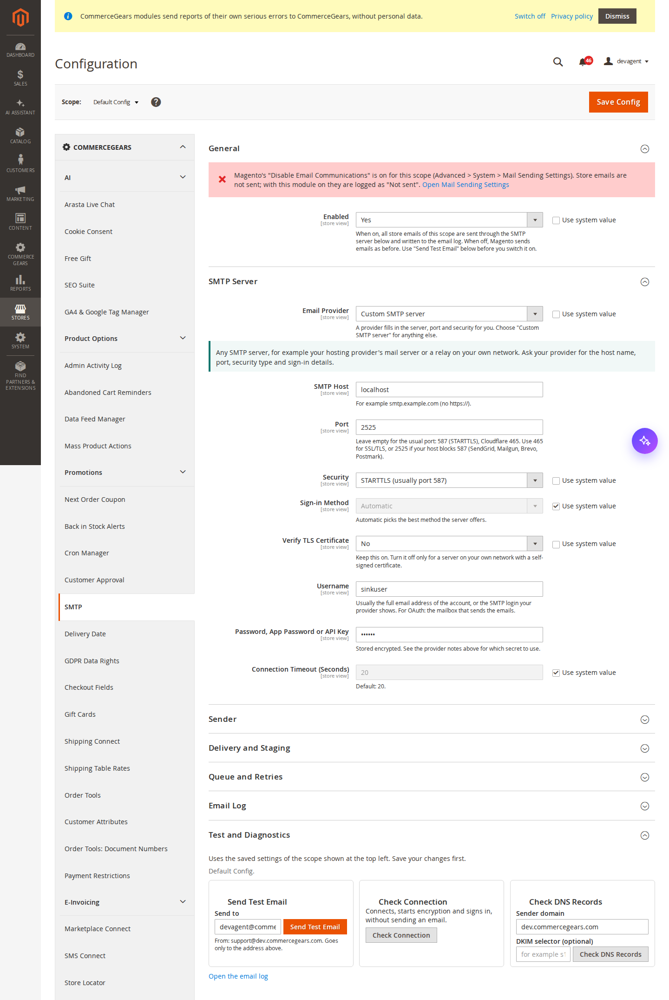
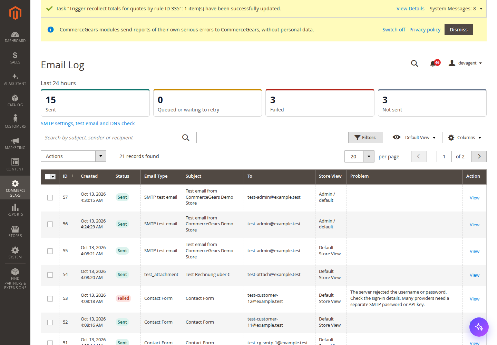
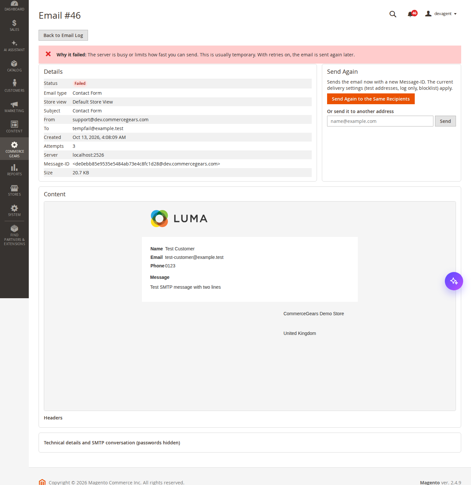
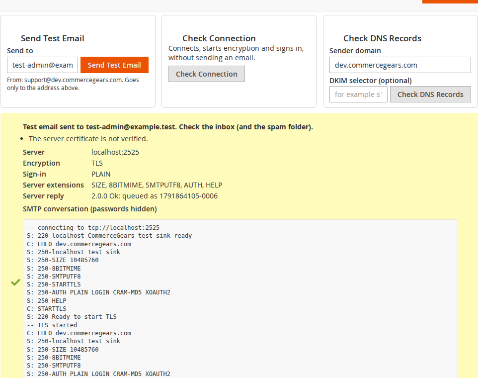
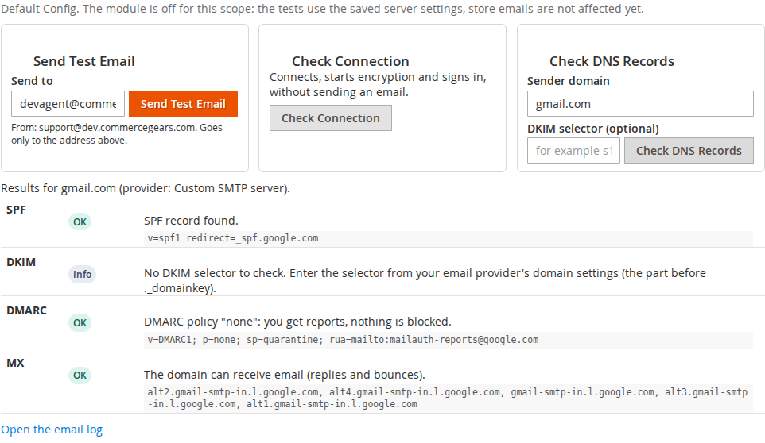

# SMTP for Magento 2: User Guide

SMTP sends every email your Magento store sends (order, invoice and shipment emails, account and password emails, the
contact form, newsletters and emails from other modules) through the email service you choose: Google Workspace,
Microsoft 365, Amazon SES, SendGrid, Mailgun, Brevo, Postmark, Mailjet, Zoho Mail, Cloudflare Email Service or any
SMTP server. It signs in to Google and Microsoft 365 with OAuth 2.0, keeps a searchable log of every email, sends
failed emails again automatically, explains errors in plain words and protects staging copies from emailing real
customers.

- Changelog: [CHANGELOG.md](../CHANGELOG.md) · Questions: [FAQ](faq.md)



## 1. Requirements

| | |
| --- | --- |
| Magento | Open Source or Adobe Commerce 2.4.6 to 2.4.9 |
| PHP | 8.2 to 8.5 (extensions openssl and zlib) |
| Storefront | Not affected: the module works in the background and in the admin only, so Luma, Hyvä and Hyvä Checkout all work |
| Cron | Magento cron, for background sending, retries and log clean-up |
| Other | `commercegears/module-core` (installed automatically) |

Magento has had a basic SMTP option since 2.4.6 (Advanced > System > Mail Sending Settings). This module replaces it
when it is switched on for a store view, and adds OAuth 2.0, presets, a test button, the log, retries and the staging
tools. Leave Magento's own Transport setting as it is; it is used again when you switch this module off.

## 2. Installation

With Composer. Use the Composer keys from your account (see https://commercegears.com/composer-access/):

```bash
composer require commercegears/module-smtp
bin/magento module:enable CommerceGears_Core CommerceGears_Smtp
bin/magento setup:upgrade
bin/magento setup:di:compile            # production mode only
bin/magento setup:static-content:deploy # production mode only
bin/magento cache:flush
```

If another SMTP module is installed (for example Mageplaza SMTP or MagePal SMTP), switch it off first: two modules
cannot both take over the mail transport.

## 3. Quick start

1. Open *Stores > Configuration > CommerceGears > SMTP*.
2. Under **SMTP Server**, choose your **Email Provider**. The grey box under it shows the server that will be used and
   where to find the details you need.
3. Enter the username and password (or API key), or the OAuth details (section 5). Click **Save Config**.
4. In **Test and Diagnostics**, click **Send Test Email**. If it fails, the panel tells you why and what to change.
5. Set **Enabled** to Yes and save. From now on every store email goes through your provider and appears in
   *CommerceGears > SMTP > Email Log*.

Every setting can be different per website and store view: use the scope switcher at the top left, for example to
send the German store's emails from a different account.

## 4. SMTP Server settings

| Setting | What it does |
| --- | --- |
| Email Provider | A preset fixes the server and security. "Custom SMTP server" leaves everything open. |
| SES Region / Mailgun Region / Zoho Data Centre | Shown for these providers; choose where your account is. |
| SMTP Host | Custom server only, for example `smtp.example.com`. Pasted `https://` and ports are removed. |
| Port | Empty = the usual port (587, Cloudflare 465). Port 465 and 2465 use SSL/TLS, all others STARTTLS. Use 2525 if your host blocks 587 (SendGrid, Mailgun, Brevo, Postmark). Ports of other services (for example 22, 80, 443, 3306, 6379) are refused. |
| Security | Custom server: STARTTLS, SSL/TLS or None. Presets always encrypt. |
| Sign-in Method | Custom server: Automatic (best method the server offers), PLAIN, LOGIN, CRAM-MD5 or None. |
| Verify TLS Certificate | Custom server: keep Yes. Turn off only for a relay on your own network with a self-signed certificate. |
| OAuth Sign-in Type | Microsoft 365 (OAuth 2.0) only: "Sign in with the mailbox" or "App-only" (section 5). |
| Username | Usually the full email address. Hidden for SendGrid (always `apikey`), Postmark (the token) and Cloudflare (always `api_token`). |
| Password, App Password or API Key | Stored encrypted. Hidden for OAuth. |
| OAuth Client ID / Secret / Microsoft Tenant ID / Redirect URI / Connected Account | OAuth providers only (section 5). |
| Connection Timeout | Seconds to wait for the server, 5 to 120. Default 20. |

Notes per provider (also shown on the settings page):

- **Gmail / Google Workspace (app password)**: a 16-character app password from myaccount.google.com/apppasswords,
  which needs 2-Step Verification. Your normal Google password is refused. Google may show the signed-in account as
  sender unless the store address is a "Send mail as" alias; or use **Send All Emails From**.
- **Microsoft 365 (password)**: only works while basic authentication is still allowed for your tenant and
  "Authenticated SMTP" is on for the mailbox. Microsoft is switching basic authentication for SMTP off; use OAuth.
- **Amazon SES**: the SMTP credentials created in the SES console (not your AWS access keys); sender verified in the
  same region; accounts in the sandbox can only send to verified addresses.
- **SendGrid**: an API key with "Mail Send" permission as the password.
- **Mailgun**: the SMTP credentials of your sending domain, for example `postmaster@mg.example.com`.
- **Brevo**: the SMTP login and an SMTP key from SMTP & API > SMTP (not your account password).
- **Postmark**: the Server API token; the default transactional stream is used.
- **Mailjet**: API key as username, secret key as password.
- **Zoho Mail**: full address; an application-specific password when two-factor authentication is on.
- **Cloudflare Email Service**: an API token with "Email Sending: Edit" as the password; port 465 only. Cloudflare
  offers SMTP as a beta service and the domain must use Cloudflare DNS.

## 5. OAuth 2.0 for Google and Microsoft 365

OAuth replaces the stored password with a sign-in that Google or Microsoft can revoke and that keeps working after
password changes. The module uses the XOAUTH2 SMTP sign-in.

### Google (Gmail and Google Workspace)

1. In Google Cloud Console create a project, then *APIs & Services > Credentials > Create credentials > OAuth client
   ID*, type **Web application**.
2. Add the **Redirect URI** shown on the settings page (use **Copy**) under *Authorised redirect URIs*.
3. On the consent screen, choose **Internal** (Workspace) or publish the app (**In production**). While an app is in
   "Testing", Google ends the sign-in after 7 days.
4. In Magento choose **Gmail or Google Workspace (OAuth 2.0)**, enter the client ID, client secret and the mailbox as
   **Username**, save, then click **Connect Account** and sign in with that mailbox.
5. Back in Magento the row shows "Connected" with the account. Click **Check Connection**.

### Microsoft 365, signing in with the mailbox

1. In Microsoft Entra ID, *App registrations > New registration*. Under *Authentication* add a **Web** platform with
   the **Redirect URI** from the settings page.
2. *Certificates & secrets*: create a client secret and copy its **value**.
3. *API permissions*: add *Office 365 Exchange Online* (or Microsoft Graph) delegated permission **SMTP.Send** and
   `offline_access`.
4. Make sure **Authenticated SMTP** is on for the mailbox (Microsoft 365 admin centre > Users > the user > Mail >
   Manage email apps). It is needed even with OAuth.
5. In Magento choose **Microsoft 365 (OAuth 2.0)**, sign-in type **Sign in with the mailbox**, enter client ID, secret,
   tenant ID (or leave it empty) and the mailbox as Username, save and click **Connect Account**.

### Microsoft 365, app-only (no sign-in)

App-only uses the client credentials flow: nothing to reconnect, no refresh token that can expire. An Exchange
administrator sets it up once:

1. Register the app and create a secret as above (no redirect URI needed).
2. Add the *Office 365 Exchange Online* **application** permission **SMTP.SendAsApp** and grant admin consent.
3. In Exchange Online PowerShell, register the app's service principal and give it access to the mailbox:
   `New-ServicePrincipal -AppId <client ID> -ObjectId <object ID from Enterprise applications>`, then
   `Add-MailboxPermission -Identity shop@example.com -User <service principal ID> -AccessRights FullAccess`.
4. Make sure Authenticated SMTP is on for the mailbox.
5. In Magento choose sign-in type **App-only**, enter client ID, secret, **tenant ID** (required) and the mailbox as
   Username, save and click **Check Connection**.

**Disconnect** removes the stored sign-in of the scope you are in. A connection made at Default Config is used by all
store views that do not have their own.

## 6. Sender

**Send All Emails From** replaces the From address of every email with one address, keeps the store's sender name
and adds the original address as Reply-To, so customers' replies still reach the right inbox. Use it when your
account may only send from one address. The envelope sender (Return-Path) follows Magento's own *Set Return-Path*
setting in Advanced > System > Mail Sending Settings.

## 7. Delivery and staging

| Setting | What it does |
| --- | --- |
| Delivery | Send to the real recipients; send everything to the test addresses; or do not send, only log. |
| Test Addresses | Comma separated. Used by the test mode and the safety lock. |
| Subject Prefix for Test Emails | For example `[STAGING]`, added to redirected emails. |
| Always Deliver To | Addresses or domains (`@yourcompany.com`) that still get their own emails in the test modes. |
| Live Store Domain (Staging Safety Lock) | For example `www.example.com`. On any other domain (a staging or local copy of the live database), emails go to the test addresses, or are only logged when there are none. |
| Never Send To | Addresses, domains or patterns with `*` that never get emails; they are left out and noted in the log. |

Redirected emails carry an `X-CommerceGears-Original-To` header and the log shows the original recipients. Set the
live domain on your live store before you copy its database: the copy then cannot email customers, even before
anyone remembers to change a setting.

## 8. Queue and retries

- **Send Emails**: *Immediately* (default) or *In the background*: emails are queued and the cron job
  `commercegears_smtp_queue` sends them within a minute, so pages never wait for a slow server.
- **Retry Failed Emails**: when sending fails (server unreachable, temporary refusal, wrong password), the email is
  kept and sent again after 5, 15, 60 and 240 minutes. Magento sees the email as handed over, so an order is not
  marked as "email not sent". **Attempts per Email** (2 to 10, default 4) includes the first try. After the last
  attempt the email is marked *Failed*.

## 9. Email log

*CommerceGears > SMTP > Email Log* lists every email with its status:

- **Sent**, **Queued**, **Waiting to retry**, **Failed** (with the reason in plain words) and **Not sent** (held back by
  log-only mode, the safety lock, the blocklist or Magento's "Disable Email Communications").



Above the grid you see the counts of the last 24 hours. Search by subject, sender or recipient, and filter by
status, email type (for example "New Order" or "Reset Password"), store view and dates. **View** opens the email:
details, a safe preview of the HTML (scripts and forms are blocked), the text version, the headers, the attachment
list and, for failures, the SMTP conversation.



**Send Again** sends the email now with a new Message-ID (mailboxes drop messages whose ID they have seen); **Send**
to another address helps when a customer gave a wrong address. In the grid, the **Send Again** mass action queues the
selected emails for cron; **Delete** removes entries.

Log settings (Default Config only): **Log Emails**, **Keep Email Content** (needed for preview and resend; emails can
contain personal data and links such as password resets, so keep the retention short), **Keep Log Entries For
(Days)** (default 30, 0 keeps everything; cleaned daily) and the optional **Keep Email Content For (Days)**, which
deletes the body and attachments sooner than the log entry (for example after 7 days). When you switch "Keep Email
Content" off, content already stored is deleted at the next daily clean-up.

If the server permanently refuses one recipient (for example a mistyped address) while accepting the others, the email
still goes to the others and the log notes the refused address.

## 10. Test and Diagnostics



- **Send Test Email** sends a short email to the address you enter, from the store's sender. Delivery mode and
  blocklist do not apply to it. It is written to the log as "SMTP test email".
- **Check Connection** connects, starts encryption and signs in without sending anything.
- **Check DNS Records** checks the sender domain: SPF (missing, more than one record, provider not included, `+all`,
  too many lookups), DKIM (the provider's usual selectors or the one you enter), DMARC policy and MX. Missing SPF,
  DKIM or DMARC is the most common reason store emails land in spam.



Both test buttons use the saved settings of the scope you are in, so save first. A warning box at the top of the
settings tells you when Magento's "Disable Email Communications" is on, when a test mode or the safety lock is
active, when an OAuth sign-in failed and when queued emails are waiting because cron does not run. An admin notice
appears when emails failed in the last 24 hours.

## 11. CLI commands

```bash
bin/magento commercegears:smtp:test --to=you@example.com [--store=1|--website=1] [--transcript]
bin/magento commercegears:smtp:test --check-only [--store=1]
bin/magento commercegears:smtp:queue [--limit=200]
bin/magento commercegears:smtp:clean [--days=30]
bin/magento commercegears:smtp:dns [domain] [--selector=s1] [--store=1]
```

`test` and `dns` return exit code 1 on failure, which makes them useful in deployment checks.

## 12. Permissions (ACL)

| Resource | Allows |
| --- | --- |
| CommerceGears > SMTP > View Email Log | the log grid and email pages |
| Resend and Delete Emails | Send Again, send to another address, mass actions |
| Settings, Test and Diagnostics | the settings page, test buttons, Connect and Disconnect |

## 13. Troubleshooting

- **"Google rejected the username or password"**: use an app password or OAuth.
- **"Microsoft 365 does not allow SMTP sign-in for this mailbox"**: turn on Authenticated SMTP for the mailbox, or
  move to OAuth if basic authentication is off for the tenant.
- **"does not allow this mailbox to send as the From address"** (SendAsDenied): set Send All Emails From to the
  mailbox, or grant Send As for the store address.
- **"did not answer" / "refused the connection"**: your host blocks the port. Try 587 or 2525, or ask your host.
- **"port and the encryption type do not match"**: 587 is STARTTLS, 465 is SSL/TLS.
- **Emails logged as "Not sent"**: the note tells you why (log-only mode, safety lock, blocklist, or Magento's
  "Disable Email Communications").
- **Queued emails do not leave**: Magento cron is not running. Run `bin/magento commercegears:smtp:queue` to test.
- **Emails arrive in spam**: run Check DNS Records and fix SPF, DKIM and DMARC with your provider.

## 14. Uninstall

```bash
bin/magento module:disable CommerceGears_Smtp
composer remove commercegears/module-smtp
bin/magento setup:upgrade
```

Magento then sends emails with its own settings again. The tables `commercegears_smtp_log`,
`commercegears_smtp_log_content` and `commercegears_smtp_oauth_token` and the settings under
`commercegears_smtp/*` stay in the database until you remove them.
